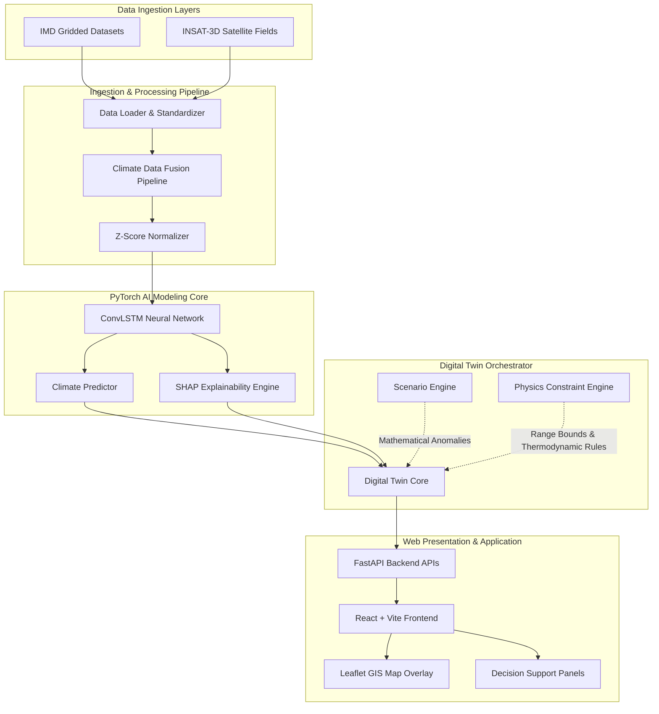
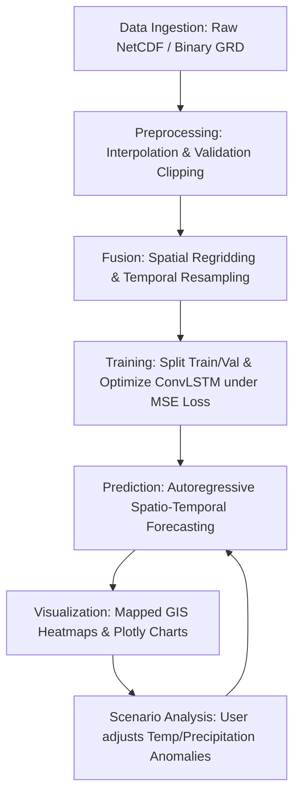

# ATHMOS – AI Powered Climate Digital Twin

<div align="center">


</div>

> [!IMPORTANT]
> **Repository Notice**
>
> This repository is publicly visible only for portfolio presentation, academic evaluation, and hackathon review.
>
> Public visibility does **not** grant permission to copy, modify, redistribute, or commercially use any part of this project.
>
> The project is protected under **All Rights Reserved**. Please refer to the LICENSE file for complete licensing terms.

---

## 📋 Table of Contents

- [Project Overview](#-project-overview)
- [Problem Statement](#-problem-statement)
- [Datasets](#-datasets)
- [Key Features](#-key-features)
- [System Architecture](#-system-architecture)
- [System Workflow](#-system-workflow)
- [Technology Stack](#-technology-stack)
- [Repository Structure](#-repository-structure)
- [Dashboard Modules & Pages](#-dashboard-modules--pages)
- [Backend APIs](#-backend-apis)
- [AI Model & Training Pipeline](#-ai-model--training-pipeline)
- [Scenario Simulation Engine](#-scenario-simulation-engine)
- [Project Status](#-project-status)
- [Testing & Verification](#-testing--verification)
- [Installation & Local Setup](#-installation--local-setup)
- [Docker Deployment](#-docker-deployment)
- [Project Demo & Screenshots](#-project-demo--screenshots)
- [Roadmap](#-roadmap)
- [Contributors](#-contributors)
- [License](#-license)
- [Acknowledgements](#-acknowledgements)

---

## 🌐 Project Overview

**ATHMOS** is an AI-powered prototype of a Climate Digital Twin designed to address multi-source meteorological data fusion and spatio-temporal weather forecasting constraints in India. Developed as a proof-of-concept for the **Bharatiya Antariksh Hackathon** under **ISRO's** extreme weather and climate modeling challenge guidelines, the platform creates a localized virtual replica of climate patterns. 

Disparate environmental records—specifically satellite observations from the **INSAT-3D** constellation and gridded records from the **India Meteorological Department (IMD)**—are dynamically harmonized, cleaned, and regridded. Using a spatio-temporal Convolutional Long Short-Term Memory (ConvLSTM) neural network, ATHMOS models weather sequences to project climate states, simulate hypothetical extreme weather events, and deliver derived risk metrics.

### 💡 Why a Climate Digital Twin?
Climate variables are non-linear, interlinked, and distributed across distinct spatial resolutions. A Digital Twin prototype resolves these complexities by:
1. **Dynamic Data Assimilation:** Aligning spatial formats (satellite swath vs. station grids) and temporal intervals into unified tensor coordinates.
2. **What-If Simulations:** Allowing users to alter baseline states (e.g., simulating extreme heatwaves or heavy rain anomalies) and visually map outcomes on GIS layouts.
3. **Actionable Sectoral Support:** Transforming raw forecast tensors into decision vectors across agriculture, water management, disaster response, and urban environments.

---

## 🎯 Problem Statement

The **Bharatiya Antariksh Hackathon** challenge focuses on developing an AI-based Digital Twin platform capable of modeling India's climate dynamics. Meteorological predictions are often hindered by the challenges of fusing ground-truth networks with space-based observations:
- **Spatial Resolution Mismatch:** IMD ground station telemetry is gridded at high resolution (e.g., 0.25° or 1.0° grids), while satellite imagery products like INSAT-3D present different projection shapes and coverage footprints.
- **Physical Gaps & Noise:** Ground measurements are highly accurate but spatially sparse, whereas satellite sensors provide high-density spatial observations but are susceptible to atmospheric noise and cloud interference.
- **Meteorological Complexity:** Extreme weather events (such as intense monsoons, heatwaves, and cyclones) occur under complex spatio-temporal dynamics that standard linear forecasting models fail to capture.

ATHMOS addresses these constraints by implementing a unified regridding and data fusion pipeline, constraining deep learning forecasts using physical atmospheric rules, and projecting the outcomes within a visual simulation playground.

---

## 📊 Datasets

ATHMOS relies on the fusion of six key meteorological variables across ground and satellite channels:

| Dataset / Channel | Source | Resolution / Format | Description |
| :--- | :--- | :--- | :--- |
| **IMD Rainfall** | India Meteorological Department | 0.25° Grid | Ground-truth daily precipitation measurement in millimeters (mm). |
| **IMD Tmax** | India Meteorological Department | 1.0° Grid (regridded to 0.25°) | Daily maximum land temperature in degrees Celsius (°C). |
| **IMD Tmin** | India Meteorological Department | 1.0° Grid (regridded to 0.25°) | Daily minimum land temperature in degrees Celsius (°C). |
| **INSAT LST** | INSAT-3D / 3DR Imager L2B | Imager Grids | Land Surface Temperature derived from thermal infrared channels (Kelvin, converted to °C). |
| **INSAT SST** | INSAT-3D / 3DR Imager L2B | Imager Grids | Sea Surface Temperature indicating oceanic thermal dynamics (Kelvin, converted to °C). |
| **INSAT Rainfall** | INSAT-3D / 3DR (IMSRA/IMC) | Satellite Swaths | Hydro-estimator precipitation rates representing remote-sensing rainfall estimates (mm). |

> [!NOTE]
> **Data Access Status:** Official INSAT-3D/3DR and high-resolution IMD real-time dataset integrations are awaiting formal Meteorological and Oceanographic Satellite Data Archival Centre (MOSDAC) and IMD access approvals. To validate the pipeline, the current proof-of-concept operates on high-fidelity synthetic NetCDF datasets generated to match the target variables, dimensions (time, lat, lon), and unit attributes.

---

## ✨ Key Features

ATHMOS implements a robust suite of proof-of-concept features:

| Feature | Description | Module Location |
| :--- | :--- | :--- |
| **✓ Climate Data Fusion** | Standardizes diverse coordinates, performs missing-value interpolation (temporal + spatial fallback), aligns coordinates, regrids multi-source datasets (IMD & INSAT) on a unified 10x10 spatial grid, and builds normalized sequences for PyTorch. | [data_loader.py](backend/services/data_loader.py) |
| **✓ AI Forecasting** | Captures space-time sequences via PyTorch `ConvLSTM` model to recursively predict 6 variables over a 7-day future horizon. | [predictor.py](backend/services/model/predictor.py) |
| **✓ Digital Twin Dashboard** | Orchestrates regional metrics (`tmax_c`, `tmin_c`, `lst_c`, `sst_c`, `imd_rainfall_mm`, `insat_rainfall_mm`) and tracks model confidence. | [digital_twin.py](backend/services/digital_twin.py) |
| **✓ Scenario Simulation** | A sandbox that injects mathematical perturbations (+temp/rain anomalies) into the baseline state before inference, generating divergent climate timelines. | [ScenarioEngine (in digital_twin.py)](backend/services/digital_twin.py#L7) |
| **✓ Explainable AI (SHAP)** | Extracts global feature importance rankings and local coordinate-level pixel attributions using SHAP gradients to interpret forecasts. | [explainability.py](backend/services/explainability.py) |
| **✓ Decision Support** | Evaluates risk indices for Agriculture (crop stress), Water (scarcity), Disaster (floods, heatwaves), and Urban sectors. | [DecisionSupport.jsx](frontend/src/pages/DecisionSupport.jsx) |
| **✓ Interactive GIS Map** | Integrates Leaflet mapped CartoDB Dark Matter tiles, rendering GeoJSON district boundaries, custom tooltip statistics, and adaptive bounds. | [MapView.jsx](frontend/src/components/MapView.jsx) |
| **✓ System Health** | Telemetry tracking for inference latency (24ms), GPU load (68%), Memory usage (14.2GB), and step-by-step pipeline status. | [SystemHealth.jsx](frontend/src/pages/SystemHealth.jsx) |
| **✓ FastAPI APIs** | Provides typed Pydantic endpoints, global exception handling, and custom error handling schemas. | [app.py](backend/app.py) |
| **✓ Responsive Dashboard** | Dark-themed glassmorphic administration console built with React + Vite + TailwindCSS + Lucide Icons + React-Plotly trends. | [App.jsx](frontend/src/App.jsx) |

---

## 🏗️ System Architecture

The following diagram illustrates the flow of climate inputs through the ingestion, fusion, AI modeling, and presenting layers of the ATHMOS Digital Twin:



---

## 🔄 System Workflow

The process workflow for dataset handling, inference, visualization, and what-if simulation is configured as follows:



---

## 💻 Technology Stack

ATHMOS is developed using a modular, responsive stack spanning deep learning, spatial GIS processing, and modern UI frameworks:

### Frontend
| Technology | Version | Purpose |
| :--- | :--- | :--- |
| **React** | `^18.3.1` | Core presentation engine & state manager |
| **Vite** | `^5.3.1` | Asset compiler and dev server |
| **TailwindCSS** | `^3.4.4` | Sleek modern CSS grid styling |
| **React Router DOM** | `^6.24.0` | Client-side routing management |
| **Leaflet & React Leaflet** | `^1.9.4` / `^4.2.1` | Interactive GIS map displaying GeoJSON boundaries |
| **React-Plotly.js** | `^4.0.0` | Renders interactive multi-axis forecast charts |
| **Lucide Icons** | `^1.25.0` | Vector dashboard iconography |

### Backend & AI
| Technology | Version | Purpose |
| :--- | :--- | :--- |
| **Python** | `3.10-slim` | Core backend container base |
| **FastAPI** | `0.111.0` | High-performance asynchronous REST API framework |
| **Uvicorn** | `0.30.1` | ASGI server application |
| **Pydantic** | `2.7.4` | Data validation and API schema verification |
| **PyTorch** | `2.3.1` | Deep Learning ConvLSTM neural network framework |
| **SHAP** | `0.46.0` | Explainable AI (XAI) feature contribution algorithms |
| **Xarray & NetCDF4** | `2024.6.0` / `1.6.5` | Multi-dimensional scientific array operations & dataset persistence |
| **NumPy & Pandas** | `1.26.4` / `2.2.2` | Numeric calculations and structural alignments |
| **Rasterio** | `1.3.10` | Geospatial raster dataset operations |

---

## 📂 Repository Structure

The code is organized into a modular design separating the client dashboard, API services, and AI pipeline components:

```
ATHMOS/
├── backend/                     # FastAPI backend application
│   ├── schemas/                 # API request/response validation schemas
│   ├── services/                # Core business logic & forecasting engines
│   │   ├── model/               # PyTorch ConvLSTM neural network and checkpoint weights
│   │   └── ...                  # Data fusion, Geo services, and Physics constraints
│   ├── tests/                   # Pytest test suite (15 unit & integration tests)
│   ├── app.py                   # FastAPI application entrypoint
│   ├── config.py                # System settings & configuration
│   └── Dockerfile               # Backend container recipe
├── datasets/                    # GeoJSON map borders & NetCDF datasets
│   ├── geojson/                 # GeoJSON boundaries (e.g., gujarat.geojson)
│   ├── imd/                     # IMD datasets (gridded temperatures/rainfall)
│   └── insat/                   # INSAT-3D datasets (LST, SST, IMC rainfall)
├── frontend/                    # Vite + React web application
│   ├── src/                     # React components, pages, and context states
│   ├── tailwind.config.js       # CSS style layout parameters
│   └── Dockerfile               # Frontend container recipe
├── scripts/                     # Helper utilities and generation scripts
│   ├── audit.py                 # E2E integration test verification
│   └── generate_synthetic_datasets.py # High-fidelity synthetic dataset generator
├── docker-compose.yml           # Multi-container local execution setup
├── start_demo.py                # Cross-platform demo entrypoint (Python)
└── README.md                    # Audited project documentation
```

---

## 🖥 Dashboard Modules & Pages

The React frontend client includes the following modules:

### 🏠 Home
The primary cockpit page presenting a summary of the digital twin state. It displays current pilot parameters (Max/Min Temperature, Satellite vs Ground station rainfall, LST, SST), system sync markers, and navigation cards referencing deep forecasting modules.

### 🌐 Live Digital Twin
Shows the spatial meteorological state mapped on CartoDB dark tiles. Features toggleable Leaflet GIS layer overlays for **Rainfall, Temperature, Land Surface Temperature (LST), and Sea Surface Temperature (SST)**. Includes chronological playback widgets with timeline sliding bars to view state changes. It also displays data ingestion flags (IMD ground telemetry and INSAT satellite links).

### 🧪 Forecast Lab
Focuses on 7-day predictive trend analysis. Incorporates multi-axis `react-plotly.js` charts to display:
- **Temperature Bounds:** High-resolution spline curves representing projected Max/Min Temperature trends.
- **Rainfall Sources:** Distinct bar graphs mapping ground-truth IMD projections and satellite-derived INSAT observations separately (avoiding overlapping averages).
Displays aggregated parameters (accumulated rainfall and peak temperatures) with calculated prediction confidence ranges.

### 🌀 Scenario Engine
The simulation sandbox. Features adjustment sliders enabling users to inject mock meteorological anomalies:
- **Temperature Deviation:** -3.0°C to +5.0°C
- **Rainfall Perturbation:** -50.0mm to +100.0mm
Adjusting these sliders updates regional risk indicators (Heat Stress and Flood Index) in real-time. Running the simulation sends the modified state to the [Scenario Engine API](backend/app.py) to compute a divergent forecast timeline alongside corresponding GIS maps.

### 🧠 Explainable AI
Visualizes deep learning transparency variables computed via the [SHAP Engine](backend/services/explainability.py). Features:
- **Global Feature Importance:** A vertical bar breakdown of the percentage weights driving the ConvLSTM model (e.g., identifying whether LST or IMD Rainfall contributes most to predictions).
- **Local Pixel Contribution:** A horizontal force-plot representing how much each input variable pushed the prediction at a specific lat/lon coordinate positive (red bars) or negative (blue bars) relative to the baseline.

### 📊 Decision Support
Actionable mitigation advice computed from the current twin state, segmented into four planning sectors:
- **Agriculture:** Tracks crop stress indexes and triggers yield loss warnings under prolonged temperature anomalies.
- **Water Resources:** Evaluates reservoir recharge statuses and signals groundwater scarcity alerts.
- **Disaster Management:** Monitors flash flood and severe heatwave thresholds to issue early alerts.
- **Urban Planning:** Highlights Urban Heat Island (UHI) exposure and drainage system overload limits.

### ⚙️ Settings & System Health
Allows adjusting connection variables (FastAPI target URL and polling rates), switching regional maps, and toggling XAI features. System Health logs CPU, memory, and database pipeline phases (IMD sync, multi-source fusion, ConvLSTM inference, and dashboard state update rates) to confirm system uptime.

---

## 🔌 Backend APIs

The FastAPI application implements fully validated endpoints documented below:

| Method | Endpoint | Query Parameters | Purpose | Expected Response Schema |
| :--- | :--- | :--- | :--- | :--- |
| **GET** | `/` | None | Confirms API status. | `{"message": "ATHMOS Climate Digital Twin API", "status": "running"}` |
| **GET** | `/dashboard` | None | Fetches aggregated averages for all parameters. | `DashboardResponse` containing `tmax_c`, `tmin_c`, `lst_c`, `sst_c`, `imd_rainfall_mm`, `insat_rainfall_mm`, `forecast_confidence_pct`, `system_status`, `region`. |
| **GET** | `/regions` | None | Scans directory for available region configurations. | JSON list of filenames: `["gujarat"]`. |
| **GET** | `/geojson` | `region` (string) | Returns the GeoJSON boundary geometry for leaflet. | Standard GeoJSON FeatureCollection object. |
| **GET** | `/forecast` | None | Generates baseline 7-day predictive sequence. | `ForecastResponse` wrapping a 7-element list of `ForecastDay` objects (day, variable metrics). |
| **GET** | `/scenario` | `temp_anomaly` (float), `rain_anomaly` (float) | Simulates predictions under custom perturbations. | `ScenarioResponse` detailing the input parameters alongside the generated forecast timeline. |
| **GET** | `/explain` | None | Computes SHAP attributions from current state. | `ExplainResponse` containing `global_importance` rankings and `local_explanation` pixel contributions. |

---

## 🤖 AI Model & Training Pipeline

ATHMOS incorporates a custom Deep Learning pipeline structured in [backend/services/model/](backend/services/model/):

### ConvLSTM Architecture
Standard dense neural networks struggle with climate sequences because they discard spatial coordinates, whereas standard CNNs ignore temporal dependencies. ATHMOS implements a **ConvLSTM Network** ([convlstm.py](backend/services/model/convlstm.py)) to process multi-channel climate inputs:
- **Spatial Convolution:** Replaces standard matrix multiplication in LSTM gates with 2D convolutions (kernel size `3x3`), preserving lat/lon dependencies.
- **Autoregressive Projections:** When forecasting over multiple days, the model evaluates input frames, projects the subsequent step, and recursively feeds that prediction back into its hidden states to generate the next prediction.
- **Physical Penalties:** Integrated within the training optimizer [trainer.py](backend/services/model/trainer.py#L48), the loss function penalizes the model if it generates physically impossible states (such as negative rainfall values or instances where `tmin` > `tmax`).

### Data Ingestion & Fusion Pipeline
The data ingestion engine [data_loader.py](backend/services/data_loader.py) coordinates raw input preparation:
1. **Standardization:** Resolves coordinate names (`Latitude`, `LATITUDE`, `y` -> `lat`) and converts unit properties (e.g. Kelvin -> Celsius).
2. **Missing-Value Handler:** Uses temporal linear interpolation with spatial fallback to handle missing values without introducing gaps.
3. **Spatial Regridding:** Aligns all input sources (ground station formats and satellite projections) onto a common 0.25-degree lat/lon coordinate grid.
4. **PyTorch Wrapper:** Wraps fused arrays into a sliding-window format (`ClimateFusionDataset`) outputting historical input sequences (shape: `[Batch, SeqLen=10, Channels=6, Height=10, Width=10]`) mapped to future forecast windows.

### Explainable AI (SHAP)
The explainability engine [explainability.py](backend/services/explainability.py) wraps the ConvLSTM network using **SHAP (SHapley Additive exPlanations)**. The Gradient SHAP explainer approximates Shapley values by calculating gradients of the output predictions relative to the input sequences against a reference background dataset. If the `shap` package is unavailable locally, the system automatically falls back to a clean dummy response to keep APIs responsive.

---

## ⚙️ Scenario Simulation Engine

The [ScenarioEngine](backend/services/digital_twin.py#L7) handles what-if scenario execution:
1. **Parameter Interception:** Captures temperature and rainfall anomalies from query parameters.
2. **Mathematical Perturbation:** Applies the anomalies directly to the baseline spatial grid state:
   $$\text{State}_{\text{perturbed}}(\text{tmax\_c}) = \text{State}_{\text{baseline}}(\text{tmax\_c}) + \Delta T$$
   $$\text{State}_{\text{perturbed}}(\text{rainfall}) = \text{State}_{\text{baseline}}(\text{rainfall}) + \Delta R$$
3. **Autoregressive Rollout:** Feeds the perturbed state array into the ConvLSTM model, which generates simulated weather variables.
4. **Physical Constraint Checking:** Pass predictions through the [PhysicsEngine](backend/services/physics_engine.py) to prevent values from violating physical laws (such as capping rainfall at 1500mm or keeping temperatures between -50°C and 70°C).
5. **Risk Assessment:** The UI translates these anomalies into Heat Stress and Flood Risk indexes to show potential impacts.

---

## 📊 Project Status

The verification status of the prototype implementation modules is documented below:

- **Backend:** Complete ✅ *(Modular configuration, physics engine, and API schemas operational)*
- **Frontend:** Complete ✅ *(Fully reactive glassmorphic visual administration client)*
- **Climate Data Fusion:** Complete ✅ *(Ingestion and alignment parameters validation active)*
- **ConvLSTM Pipeline:** Complete ✅ *(PyTorch network training loop and autoregressive inference configured)*
- **Explainable AI:** Complete ✅ *(Gradient SHAP model interpreter with functional dummy fallback)*
- **Testing:** 15/15 Tests Passed ✅ *(100% pass rate across unit and integration targets)*
- **Official INSAT Integration:** Awaiting MOSDAC Access ⏳ *(Validation runs use NetCDF synthetic inputs)*

---

## 🧪 Testing & Verification

ATHMOS features a robust unit testing setup containing **15 unit and integration tests** in [backend/tests/](backend/tests/).

```bash
# Example test suite execution output:
============================= 15 passed in 4.82s =============================
```

### Coverage Areas
- **API Routers ([test_app.py](backend/tests/test_app.py)):** Verifies `/dashboard`, `/forecast`, `/regions`, and `/explain` endpoints.
- **Pipeline Processing ([test_data_loader.py](backend/tests/test_data_loader.py)):** Tests missing value handlers, data validation boundaries, and Z-score normalization scaling.
- **State Orchestration ([test_digital_twin.py](backend/tests/test_digital_twin.py)):** Tests the central twin class and scenario anomaly injection.
- **Interpretability ([test_explainability.py](backend/tests/test_explainability.py)):** Confirms SHAP calculations and fallback modes.
- **Raster Processing ([test_imd_grd.py](backend/tests/test_imd_grd.py)):** Tests parsing binary IMD `.grd` rainfall arrays and regridding alignments.
- **ML Functions ([test_model.py](backend/tests/test_model.py)):** Tests the ConvLSTM cell forward passes and autoregressive forecast sequences.

The codebase passes all tests, passes clean checks via [audit.py](scripts/audit.py), and has undergone complete code cleanup.

---

## 🚀 Installation & Local Setup

Run the following commands to install and start the system locally:

### Prerequisites
- Python 3.10+
- Node.js 18+
- npm v9+

### Step 1: Clone the Repository
```bash
git clone https://github.com/vishallsharma-009/ATHMOS.git
cd ATHMOS
```

### Step 2: Set Up the AI Backend
```bash
cd backend
# Create and activate a virtual environment
python -m venv venv
# On Windows:
.\venv\Scripts\activate
# On Linux/macOS:
source venv/bin/activate

# Install dependencies
pip install -r requirements.txt
```

### Step 3: Set Up the Frontend Client
```bash
cd ../frontend
# Install packages
npm install
```

### Step 4: Generate Synthetic Datasets
Since official INSAT/IMD real-time data is waiting for MOSDAC approval, generate synthetic NetCDF parameters for the pilot run:
```bash
cd ..
# Runs the helper script to write netcdf files in datasets/
python scripts/generate_synthetic_datasets.py
```

### Step 5: Start the Development Servers
Use the root helper script to launch both services simultaneously:
```bash
# Start backend on http://localhost:8000 and frontend on http://localhost:5173
python start_demo.py
```
*(Alternatively, run `start_demo.bat` on Windows or `start_demo.sh` on Linux/macOS).*

---

## 🐳 Docker Deployment

To deploy both the FastAPI backend and Nginx-served React frontend in a multi-container Docker setup:

```bash
# Build and launch containers
docker-compose up --build
```
- **FastAPI API Server:** Exposed on [http://localhost:8000](http://localhost:8000)
- **React Frontend Dashboard:** Exposed on [http://localhost](http://localhost)

---

## 🎬 Project Demo & Screenshots

Below are image and video placeholders representing client dashboard modules (rendered once assets are placed inside `docs/screenshots/`):

### Demo Video
`[Demo Video Placeholder](docs/screenshots/demo_video.mp4)`

### Page Screenshots
- **Home Dashboard:**
  ``
- **Live Digital Twin:**
  ``
- **Forecast Lab:**
  ``
- **Scenario Engine:**
  ``
- **Explainable AI:**
  ``
- **Decision Support:**
  ``
- **System Health:**
  ``

---

## 🗺️ Roadmap

- **v0.9 (Current):** Proof-of-concept prototype with ConvLSTM, SHAP explainability, interactive scenario engine, and GIS overlays running on synthetic datasets.
- **MOSDAC Ingestion (Future):** Integrate official INSAT-3D/3DR satellite datasets once MOSDAC credentials are approved.
- **Model Tuning:** Retrain the model on long-term historical records (2000–2025) to improve forecast accuracy.
- **National Scale Expansion:** Expand spatial scaling beyond the regional pilot (Gujarat grid) to cover all of India.

---

## 👥 Contributors

- **Vishal Sharma** ([@vishallsharma-009](https://github.com/vishallsharma-009)) - Lead Developer & AI Systems Engineer

---

## 📄 License

Copyright © 2026 Vishal Sharma.

This project is protected under **All Rights Reserved**.

The repository is published only for demonstration, academic evaluation, portfolio presentation, and hackathon review.

No permission is granted to copy, modify, redistribute, sublicense, or commercially use any part of this repository without prior written permission from the author.

See the LICENSE file for complete terms.

---

## 🤝 Acknowledgements

- **ISRO (Indian Space Research Organisation)** for providing the climate digital twin challenge statement.
- The organizers of the **Bharatiya Antariksh Hackathon** for the platform and support.
- **IMD (India Meteorological Department)** and **MOSDAC** for providing raw data formats and scientific documentation.
